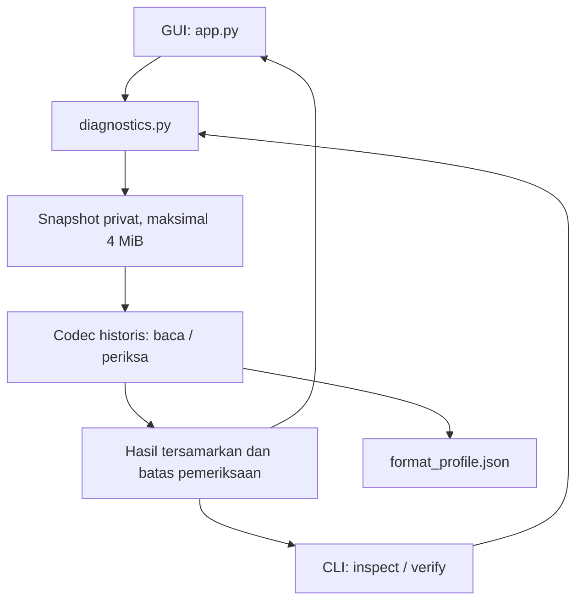

# Laporan Audit Repository — 2026-11-10

## Ringkasan eksekutif

Audit dilakukan terhadap `smahud/jibas_generator`, branch `main`, baseline
`edb62b9052d235ef7c3f5bff82580613dcb98cb1`. Working tree awal bersih.
Seluruh 61 file tracked baseline diinventaris dan ditinjau sesuai jenisnya.
Source Python dan entry point ditelusuri; arsip besar diperiksa secara statis
melalui struktur, pencarian kategori, provenance, dan hash, tanpa mengeksekusinya.
Ini bukan sertifikasi seluruh data arsip bebas informasi pribadi.

GUI sekarang khusus diagnostik read-only. Perubahan mencakup facade pembacaan
terbatas, penyamaran laporan, worker tanpa akses Tk, tampilan hasil terstruktur,
entry point CLI, launcher portabel, dokumentasi, dan regression test.
Codec, format, detector, database dump, binary/instalasi target, fixture, dan
arsip riset tidak dimodifikasi. Hasil uji terpilih: **36 passed** pada Linux.

Pesan penolakan dari aplikasi target belum direproduksi persis. Tidak ada klaim
bahwa audit memperbaiki penerimaan lisensi oleh aplikasi proprietary.

## Cakupan dan inventaris baseline

| Kelompok | Jumlah | Pemeriksaan |
|---|---:|---|
| Root | 16 | Seluruh Python, README, guide, analisis, manifest, dependency, schema, profil, launcher, gitignore |
| `tests/` | 7 | Empat modul tes dan tiga fixture; identifikasi tes baca vs tes mutasi |
| `contoh/` | 2 | Sampel dan catatan; pembacaan sampel secara offline, tanpa pembuatan ulang |
| `bukti/` | 25 | Struktur semua JSON, hasil/kontradiksi historis, string, metadata, checksum, fixture |
| `riset/` | 10 | Source C# secara statis: dependency proprietary, reflection, akses file/DB, potensi efek samping |
| `db/` | 1 | Seluruh teks dipindai; 19.595 baris, 16 definisi database, 460 tabel, 12 prosedur; tidak diimpor |

Tidak ada `AGENTS.md` di checkout. `AGENT_GUIDE.md` lama memerintahkan pengujian
seluruh suite serta sinkronisasi instalasi. Instruksi tugas terbaru membatasi
pekerjaan ke diagnostik read-only, sehingga pengujian mutasi dan deployment
tersebut tidak dijalankan. Guide diperbarui agar agent berikutnya tidak memakai
konteks mesin lama sebagai otorisasi akses produksi.

## Arsitektur dan hubungan modul



- `app.py`: entry point desktop; input → worker → antrean → polling main thread
  → tabel hasil/status/log. Tidak mengimpor detector dan tidak menawarkan mutasi.
- `diagnostics.py`: preflight sumber, pembacaan bounded, snapshot sementara,
  fungsi inspeksi/verifikasi codec, lalu allowlist metadata dan pesan tetap.
  Tidak memakai konfigurasi instalasi atau koneksi database.
- `cli.py`: `main()` dan argparse. Hanya cabang `inspect`/`verify` diarahkan ke
  facade. Wrapper `cli.cmd` menjaga cwd pemanggil. Jalur historis lain tetap ada.
- `license_codec.py`: codec historis, fungsi pemeriksaan lokal dan fungsi mutasi.
  Impor tidak mengeksekusi mutasi; hanya fungsi read-only dipakai audit.
- `id_detect.py`: database detector dan hardware detector. Hubungan dengan CLI
  historis dipertahankan, tetapi tidak dipanggil oleh GUI/tes terpilih.
- `dbid_recipe.py`: helper historis; terdapat duplikasi konstanta resep dengan
  detector. Tidak disatukan karena menyentuh area di luar perbaikan diagnostik.
- `search_db.py`: utilitas pencarian terpisah; tidak dipanggil startup GUI/CLI baca.
- `format_profile.json`: input codec saat membaca; `schema.xml`: data format
  historis yang dirujuk jalur serialisasi. Tidak ada perubahan pada keduanya.
- `MANIFEST.json`: inventaris dokumenter saat ini, bukan dependency runtime.
- `tests/`, `contoh/`, `bukti/`, `riset/`, `db/`: bukan kebutuhan startup GUI.
  Tes menggunakan fixture yang sudah tersedia; harness C# bukan modul aplikasi.

## Temuan dan tindakan

Severity mengikuti dampak pada kerahasiaan, integritas, dan kemampuan diagnosis,
bukan perkiraan eksploitasi target proprietary.

| ID | Severity | Temuan berbasis source/bukti | Tindakan/status |
|---|---|---|---|
| A01 | High | README, guide, analisis, manifest lama mempublikasikan credential/key, identitas mesin, dan prosedur mutasi | Dokumentasi aktif direkonstruksi tanpa nilainya. Arsip/source historis tetap sensitif; residual terbuka |
| A02 | High | GUI lama menggabungkan pembacaan dan pembuatan berkas dengan path yang sama serta tombol overwrite | GUI diganti alur read-only; fungsi mutasi inti tidak diubah. CLI historis tetap perlu diperlakukan terpisah |
| A03 | Medium | `run_action()` lama membaca/memeriksa pada main thread; deteksi worker memanggil Tk `after()` dari worker | Queue + worker data murni + polling main thread; uji heartbeat, guard Tcl/Tk, klik ganda, dan close lulus |
| A04 | Medium | GUI/CLI inspeksi menampilkan fields mentah, path absolut, detail ID, dan exception | Facade menyamarkan output; kode error/pesan tetap; clipboard/log tidak memuat nilai input |
| A05 | Medium | Codec `_load()` memakai `read_bytes()` sebelum batas ukuran `_decrypt()`; file khusus berpotensi memblokir | Facade membuka read-only/nonblocking jika tersedia, fstat regular file, baca maksimum batas+1; core tetap utuh |
| A06 | Medium | `cli.py` tidak memiliki main guard; `python cli.py ...` baseline keluar 0 tanpa output | Main guard ditambah; subprocess `python -m cli inspect` menghasilkan JSON dan exit code sesuai |
| A07 | Low | Launcher bergantung pada runtime pembuat; path direktori dimasukkan langsung ke kode Python yang dikutip | Prioritas venv/launcher/PATH; GUI memakai module; CLI memakai environment untuk path dan menjaga cwd. Windows belum diuji |
| A08 | Medium | Guide mengklaim dump tidak sensitif; dump memuat restore destruktif dan baris akun | Klaim ditarik, kategori risiko dicatat. Dump tidak diubah/diimpor; klasifikasi data pribadi lengkap belum selesai |
| A09 | Medium | Dokumentasi menganggap seluruh metode proven dan kondisi mesin lama masih berlaku | Pisahkan bukti historis, fakta checkout, dan hasil sesi ini; tidak klaim aktivasi/Windows/live |
| A10 | Medium | `detect` lama dapat mencetak hasil error dengan `ok: true`; pesan dan info detector memuat metadata mesin/koneksi | Didokumentasikan; detector/cabang CLI historis tidak disentuh dan tidak dijalankan |
| A11 | Low | Guide memakai jumlah tes lama; inventaris/hash adalah snapshot terdahulu | Inventaris saat ini diperbarui; hash historis dipertahankan dan diberi konteks, tanpa menyamarkannya sebagai hash rilis baru |
| A12 | Low | Tidak ada `LICENSE` pada baseline | README menyatakan status tersebut; tidak mengarang izin redistribusi atau lisensi open-source |

### Tinjauan kualitas Python dan resource

Arsitektur kecil dan layak dipertahankan; tidak perlu framework GUI, service,
plugin, atau pemecahan modul masif. Facade baru memisahkan I/O/pelaporan dari Tk
serta tidak menyalin implementasi pemeriksaan entitlement.

- Path lintas platform menggunakan `Path`; CLI Python menerima argumen lewat
  argparse. Launcher CLI tidak menanam path pengguna ke literal Python.
- File descriptor/snapshot dibersihkan lewat context manager. Log sesi dibatasi
  200 baris; jumlah worker aktif satu. Polling dibatalkan saat close.
- Worker daemon tidak dapat dibatalkan di tengah operasi. Batas byte mencegah
  alokasi input tak terbatas; filesystem jaringan/OS masih dapat lambat. GUI
  tetap dapat ditutup. Penghentian paksa proses dapat menyisakan temp OS.
- Snapshot menghindari inspeksi dan verifikasi membaca dua versi sumber berbeda.
  Perubahan ukuran/mtime saat pembacaan dideteksi; hash merepresentasikan byte
  snapshot, bukan jaminan sumber tidak berubah setelah pemeriksaan selesai.
- `verify_license()` historis memuat logika tanggal/entitlement yang tidak diubah.
  Parser historis bukan validator schema/keaslian yang lengkap. `has_license_row`
  dan `valid` tidak dipromosikan menjadi bukti aktivasi.
- `id_detect.py` masih mempunyai default credential, cursor tanpa context manager,
  pemanggilan stored procedure, dan penanganan WMI yang tidak mencakup semua
  kegagalan/timeout. `search_db.py` menelan sebagian error dan membatasi 200 baris
  per tabel; hasil pencarian tidak boleh dianggap lengkap. Tidak diuji ke DB.
- Runtime requirement tetap `cryptography` dan `PyMySQL`; pytest khusus test.
  Tidak ada dependency runtime baru. Dependency di environment uji lulus pip check.

## Investigasi bug yang dilaporkan

**Pesan:** “File terpilih bukan lisensi JIBAS Presensi Wajah”.

Pencarian literal pesan dan kedua nama metode obfuscated dari tugas pada source,
arsip string, dan harness baseline tidak menemukan kecocokan. Pada
`bukti/client16/vm_strings.txt` tersedia label filter pemilihan berkas presensi
wajah. Itu hanya petunjuk konteks, bukan pemetaan exception ke source tertentu.

**Root cause target: belum terkonfirmasi.** Berkas pemicu yang terverifikasi,
binary pemicu, versi lengkap target, dan log asli lengkap tidak tersedia.
Dugaan beda tipe/struktur/profil berkas tidak dapat dinaikkan menjadi fakta.
Severity **Medium sementara** untuk hambatan impor/diagnosis; dampak final
memerlukan bukti target. Tidak ada bukti bahwa GUI Python menghasilkan teks itu.

### Reproduksi aman dan hasil yang benar-benar diperoleh

1. Pada baseline, cari pesan di Python, `bukti/`, dan `riset/`: tidak ditemukan.
   Perintah untuk mengulangi pencarian baseline setelah docs berubah:

   ```sh
   git grep -n -F 'File terpilih bukan lisensi JIBAS Presensi Wajah' edb62b9 -- '*.py' bukti riset
   ```

   Exit `1` pada pencarian ini berarti tidak ada kecocokan, bukan kegagalan tes.
2. Baca `tests/fixtures/original-imported.enc`, `original-empty.enc`, dan sampel
   yang sudah ada. Codec membaca dua bentuk: baris data dan cache tanpa baris.
   Tidak ada byte sumber yang berubah.
3. Uji input kosong, teks yang bukan berkas lisensi, dan payload terpotong dalam
   direktori sementara. Facade mengembalikan `empty_file`/`unreadable_format`;
   tidak mengeluarkan exception mentah atau menyatakan penerimaan target.
4. Uji cache kosong pada verifikasi lokal: `valid: false`,
   `activation_proven: false`. Bandingkan check boolean pada fixture berbaris
   dengan core: sama, tetapi detail identitas pada laporan disamarkan.
5. Jalankan GUI nyata dan tes regresi yang tercantum di `TEST_REPORT.md`.

**Yang diperbaiki:** akar masalah diagnostik yang terbukti pada GUI/CLI Python,
yaitu pembacaan memblokir UI, pemaparan data mentah, dan entry point yang hilang.
**Yang tidak dinyatakan selesai:** penolakan file oleh aplikasi target. Tidak ada
perubahan pada pembuatan lisensi, kriptografi, penerimaan importer, trial, cache,
expiry, kapasitas, sequence, atau entitlement.

Untuk investigasi target berikutnya, gunakan hanya salinan yang diizinkan:
catat versi aplikasi pemicu, jenis/ukuran/hash berkas, dan log yang sudah
meredaksi data pribadi. Bila penyebab berada pada hasil pembuatan/perubahan
lisensi atau pembatasan aktivasi, cukup dokumentasikan dan gunakan dukungan
resmi penerbit; jangan mengubah mekanismenya.

## Audit keamanan dan privasi

Kategori yang ditemukan secara statis, tanpa menyalin nilainya:

| Lokasi | Kategori | Status/rekomendasi |
|---|---|---|
| Dokumentasi root lama | Credential/key, path dan identitas mesin, prosedur mutasi | Dihilangkan dari dokumentasi aktif; riwayat Git tetap menyimpan versi lama |
| `id_detect.py`, `search_db.py`, beberapa harness | Default credential/koneksi dan metadata instalasi | Dibiarkan utuh sesuai lingkup; tinjau pemakaian dan ganti credential nyata jika masih berlaku |
| `format_profile.json`, tes historis, `bukti/` | Material format/kripto, data lisensi dan mesin | Tidak disalin ke docs baru; simpan sebagai materi sensitif |
| `tests/test_id_detect.py`, `contoh/`, provenance | Identifier hardware dan data fixture historis | Tidak dianggap data sintetis yang pasti aman; belum diregenerasi |
| `db/` | Data akun, kolom pribadi, restore destruktif | Tinjau dan batasi distribusi; jangan impor ke produksi |

Tidak ada credential dipakai untuk mengakses produksi. Token GitHub dari sesi
hanya berwenang untuk operasi Git yang diminta dan tidak dimasukkan ke file,
remote URL, screenshot, atau laporan. Tidak dilakukan rewrite history atau
penghapusan bukti. Jika diperlukan sanitasi arsip/history, itu perlu pekerjaan
terpisah yang tetap menjaga provenance dan pemulihan; audit ini tidak menyatakan
repository publik telah sepenuhnya dibersihkan.

## Perubahan dan alasan

| File/kelompok | Perubahan | Alasan/risiko |
|---|---|---|
| `app.py` | UI empat tab dan antrean worker read-only | Memperbaiki UX/concurrency; GUI lama yang menulis sengaja tidak ditampilkan sesuai tugas |
| `diagnostics.py` | Facade read-only dan penyamaran | Mencegah pembacaan tak terbatas/kebocoran laporan; ada I/O snapshot sementara |
| `cli.py` | Cabang baca/periksa lewat facade, pesan input, main guard | Exit/report dapat digunakan; konsumen JSON mentah harus menyesuaikan |
| Dua `.cmd` | Runtime portabel, penanganan path, status proses | Menghapus asumsi mesin pembuat; validasi Windows masih diperlukan |
| `.gitignore` | Abaikan `.venv/` | Environment lokal tidak ikut commit |
| README, guide, analisis, manifest | Rekonstruksi sesuai source/batas bukti | Materi operasional sensitif tidak diterbitkan ulang |
| Tiga modul tes baru | Uji diagnostik/GUI/CLI dengan fixture lama | Tidak membuat lisensi/cache atau meningkatkan jalur mutasi |
| Tiga laporan dan `report/gui/` | Bukti audit, GUI, pengujian | Membuat hasil review dapat diperiksa |

File yang dipertahankan byte-identik: `license_codec.py`, `id_detect.py`,
`dbid_recipe.py`, `search_db.py`, `schema.xml`, `format_profile.json`,
`requirements.txt`, seluruh tes/fixture baseline, `contoh/`, `bukti/`, `riset/`,
dan `db/`. Tidak ada binary proprietary dalam checkout untuk diubah.

## Penilaian akhir

Perbaikan diagnostik lokal selesai dan pengujian terpilih lulus; tidak ditemukan
regresi pada pembacaan fixture dalam scope yang diuji. Bukan sertifikasi
kesiapan produksi atau aktivasi JIBAS. Masih terbuka: reproduksi penolakan target,
validasi Windows/DPI/aksesibilitas, sensitivitas arsip/source lama, dan masalah
utilitas historis di luar scope. Lihat `TEST_REPORT.md` untuk batas pengujian
serta `GUI_REVIEW.md` untuk bukti visual.
