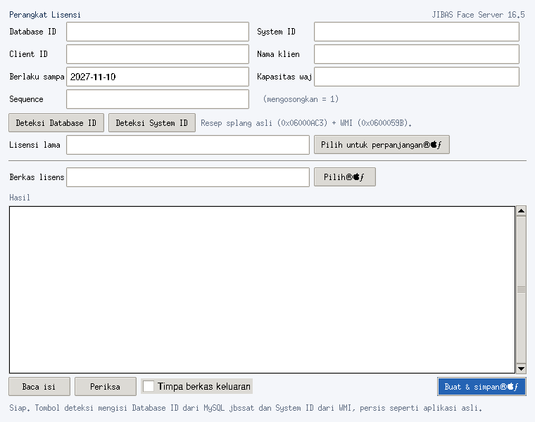
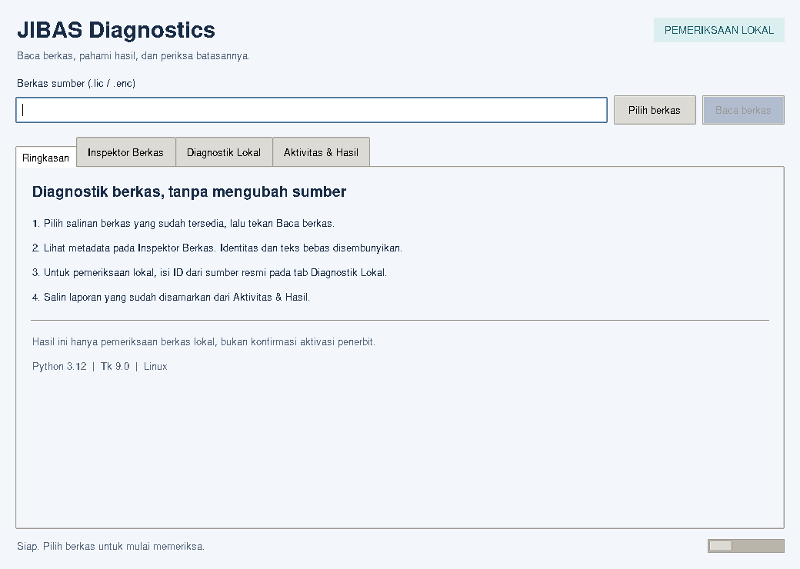
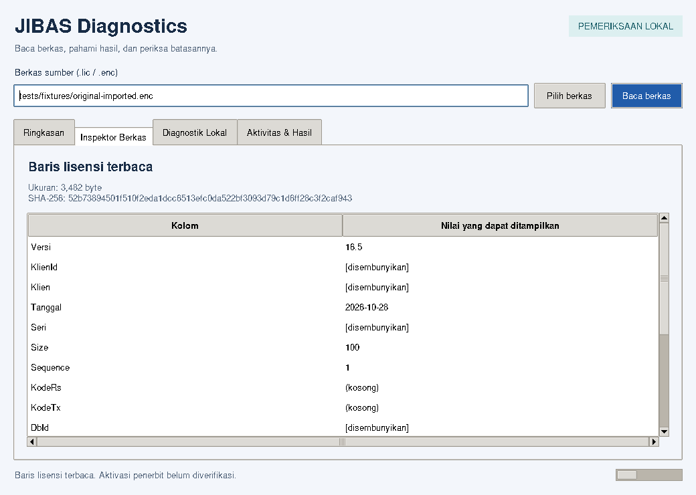
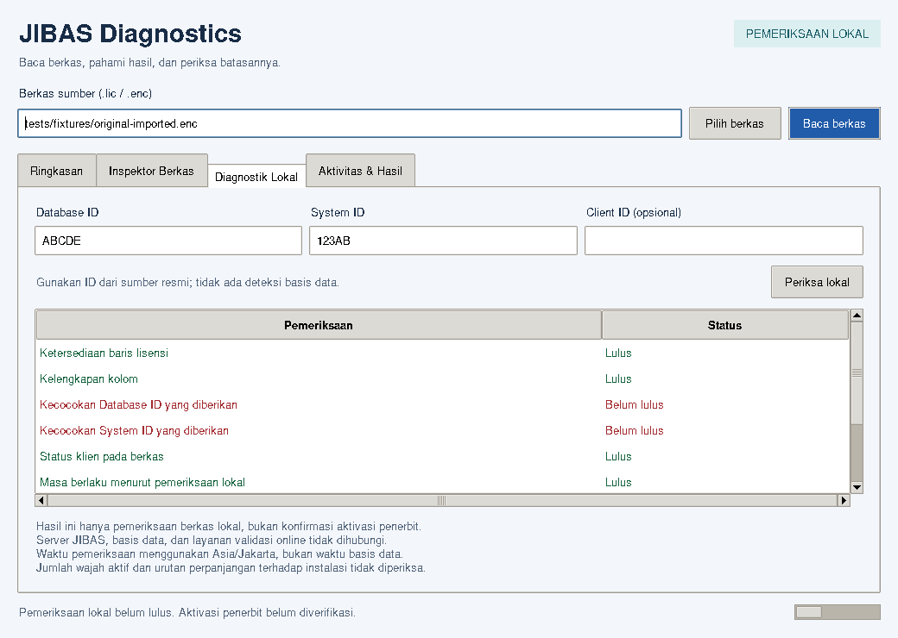
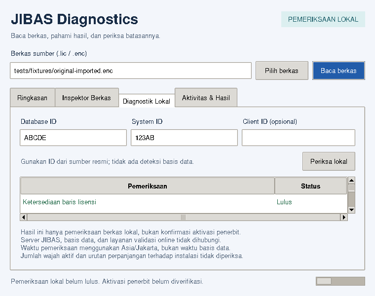
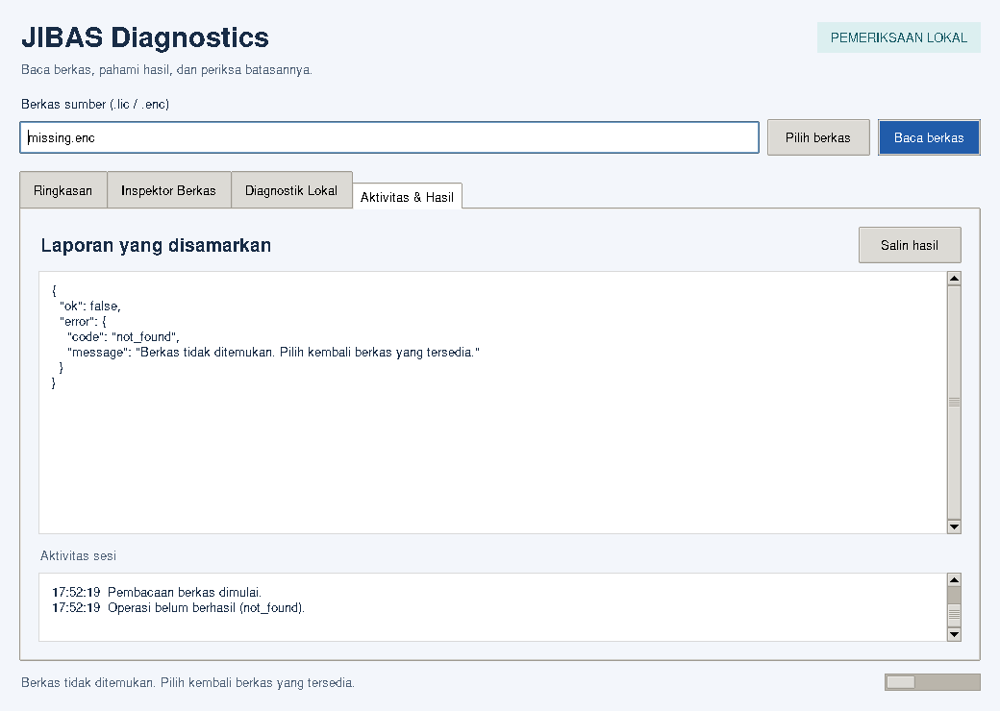

# Tinjauan GUI — 2026-11-10

## Sebelum perubahan

GUI `app.py` baseline memiliki satu form dua kolom untuk input lisensi, dua
tombol deteksi, pemilihan sumber/keluaran yang bercampur, JSON mentah, dan aksi
penulisan. Ukuran 760 × 600 (minimum 660 × 540). Label berukuran tetap memotong
teks; font yang tidak tersedia pada Linux jatuh ke fallback kecil. Pembacaan
berkas/verifikasi dijalankan langsung pada callback Tk. Worker deteksi lama
memanggil `window.after()` dari thread worker; tombol tidak dikunci saat deteksi.

## Setelah perubahan

Tkinter/ttk tetap digunakan. Tidak ada dependency GUI baru. Nama kelas
`LicenseApp` dipertahankan agar launcher/integrasi import lama tetap mengenalinya;
kontrak tampilan sekarang khusus diagnostik read-only sesuai tugas.

| Area | Perubahan dan manfaat |
|---|---|
| Header dan bar berkas | Hierarki judul/subjudul, satu sumber baca, tombol pilih dan baca yang jelas |
| Ringkasan | Panduan empat langkah, versi runtime, status dan batas diagnostik |
| Inspektor Berkas | Tabel metadata, ukuran, SHA-256 snapshot, status cache kosong/baris terbaca |
| Diagnostik Lokal | Input ID eksplisit, status Lulus/Belum lulus per cek, batas pemeriksaan selalu terlihat |
| Aktivitas & Hasil | JSON yang disamarkan, tombol salin, log sesi terbatas 200 baris, scrollbar |
| Responsivitas | Grid fleksibel; awal 1040 × 740, minimum 760 × 600; scrollbar tabel/output |
| Tipografi | Memilih font yang tersedia; font sistem sebagai fallback |
| Error | Kode stabil dan pesan tindakan, tanpa exception mentah atau dialog yang memblokir |
| Navigasi | Tab/Shift+Tab bawaan ttk; Ctrl+O, Ctrl+Enter, Ctrl+Shift+C |
| Integritas | Tidak ada form penulisan, overwrite, deteksi DB/hardware, atau penyimpanan lisensi |

## Perilaku operasi

Nilai Tk dibaca sebelum worker dimulai. Worker menerima dictionary string,
memproses facade diagnostik, lalu memasukkan hasil tersamarkan ke `Queue`.
`after()` hanya dijadwalkan main thread. Polling 40 ms memperbarui widget dan
menghentikan progress ketika hasil tersedia.

Satu operasi berjalan pada satu waktu. Tombol, path, dan input ID dikunci;
klik kedua diabaikan. Penutupan membatalkan polling dan menghancurkan GUI tanpa
menunggu worker daemon. Worker tidak memegang widget dan tetap membersihkan
snapshot melalui context manager bila prosesnya selesai.

Perubahan berkas atau ID membersihkan hasil/tabel dan menonaktifkan salin sampai
pemeriksaan baru selesai. Jika input diubah secara programatis saat busy, hasil
lama ditolak ketika diambil. Clipboard hanya menerima laporan yang disamarkan.
Input path/ID yang diketik masih terlihat pada form; hindari membagikan screenshot
input pribadi. Tidak ada fitur reveal data mentah.

## Verifikasi visual dan fungsional

Jendela Tk nyata dijalankan pada Linux/Python 3.12/Tk 9.0 dengan Xorg dummy.
Screenshot diperiksa pada ukuran awal dan minimum; uji geometri juga memeriksa
1400 × 900. Semua tab, tombol utama, input, dan area status berada dalam batas
jendela. Pada ukuran minimum, rincian tabel perlu digulir.

Pengujian mencakup pembacaan fixture, tampilan per cek, salin clipboard,
pemilihan/cancel melalui mock dialog, error, invalidasi hasil lama, worker lambat,
klik ganda, dan tutup saat proses berjalan. Guard pada interpreter Tcl/Tk
memastikan tidak ada panggilan dari thread worker selama tes.

Dialog native Windows, shortcut keyboard secara manual, screen reader, DPI
tinggi, tema Windows, dan semua resolusi belum diuji. Hasil Linux tidak dianggap
pembuktian Windows. Rincian angka pengujian pada `TEST_REPORT.md`.
