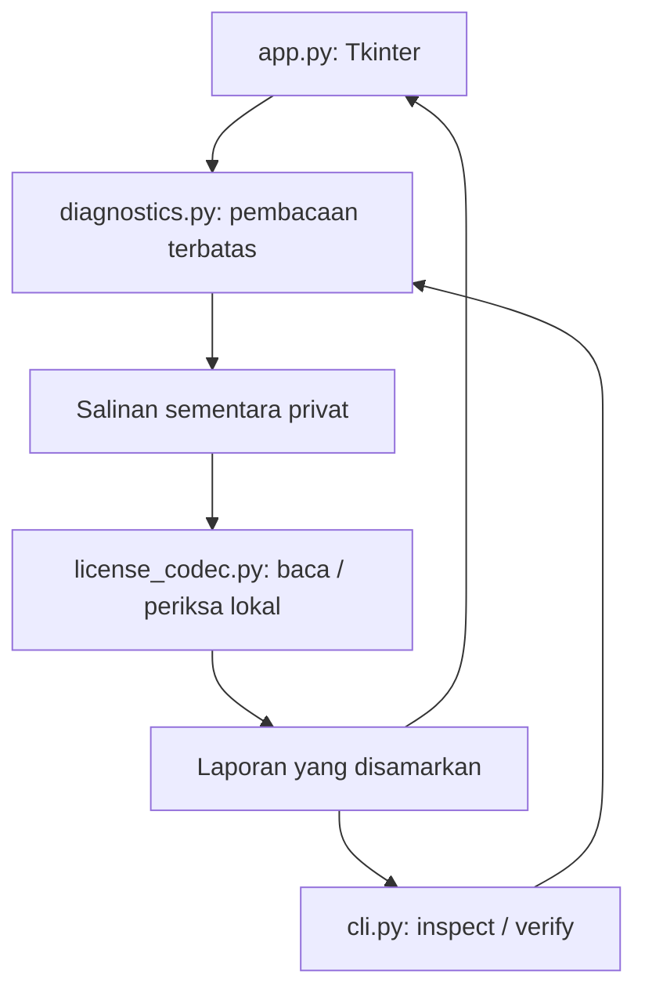
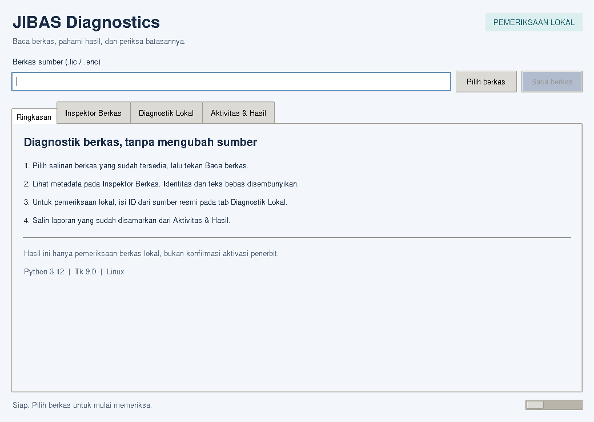

# JIBAS Generator — Diagnostik Berkas Lokal

Repository Python dengan arsip penelitian JIBAS dan antarmuka desktop **JIBAS
Diagnostics** untuk membaca berkas yang sudah tersedia. GUI saat ini hanya
menyediakan inspeksi dan pemeriksaan lokal; hasilnya **bukan konfirmasi aktivasi
atau keaslian dari penerbit JIBAS**.

Kode historis yang melakukan mutasi masih ada di repository dan CLI lama.
Audit ini tidak mengembangkan, memperbaiki, atau menguji jalur tersebut.

## Tujuan dan status

Membantu pengguna memahami apakah berkas dapat dibaca oleh codec lokal, melihat
metadata yang disamarkan, serta memahami hasil dan batas pemeriksaan offline.
Tidak diperlukan aplikasi JIBAS yang berjalan atau akses database untuk alur
GUI, `inspect`, dan `verify` dengan ID eksplisit.

Status: implementasi diagnostik lokal telah diuji pada Linux/Python 3.12/Tk 9.0.
Kompatibilitas Windows, aplikasi proprietary, dan aktivasi penerbit belum diuji
ulang dalam audit ini. Detail ada di [TEST_REPORT.md](TEST_REPORT.md).

## Fitur

- Empat tab: Ringkasan, Inspektor Berkas, Diagnostik Lokal, Aktivitas & Hasil.
- Pemilihan berkas melalui dialog sistem atau input path.
- Metadata terstruktur, ukuran byte, dan sidik SHA-256 dari byte yang diperiksa.
- Status per pemeriksaan lokal, cache kosong, kegagalan baca, dan batas hasil.
- Pembacaan maksimum 4 MiB; input folder/perangkat ditolak.
- Worker latar, indikator proses, pencegahan klik ganda, dan status operasi.
- Salin laporan JSON yang disamarkan; output dan aktivitas dapat di-scroll.
- Pembatalan penjadwalan GUI saat ditutup; hasil lama dibersihkan saat input berubah.

## Teknologi dan arsitektur

Python, Tkinter/ttk bawaan Python, dan `cryptography` untuk codec yang sudah ada.
`PyMySQL` tetap tercantum di requirements untuk utilitas historis; tidak dipakai
oleh jalur diagnostik dengan ID eksplisit. `pytest` adalah dependency pengujian.
Tidak ada framework GUI atau dependency runtime baru.



GUI membaca nilai input pada main thread. Worker hanya menghitung dan mengirim
hasil ke antrean. Main thread mengambil hasil dengan `after()` dan memperbarui
widget. Sumber dibuka read-only; salinan sementara dihapus setelah pemeriksaan.
Inspeksi dan verifikasi menggunakan byte salinan yang sama, termasuk jika sumber
berubah setelah pembacaan selesai. Tidak ada penulisan ke instalasi JIBAS.

## Struktur repository

| Path | Peran |
|---|---|
| `app.py` | Entry point GUI diagnostik read-only |
| `diagnostics.py` | Validasi input, snapshot terbatas, penyamaran, pesan error |
| `cli.py`, `cli.cmd` | CLI; dokumentasi ini hanya mencakup `inspect` dan `verify` dengan ID eksplisit |
| `license_codec.py` | Codec dan fungsi historis; tidak diubah dalam audit |
| `id_detect.py`, `dbid_recipe.py`, `search_db.py` | Deteksi/pencarian historis; tidak dipanggil GUI baru |
| `schema.xml`, `format_profile.json` | Data format lokal yang sudah ada; dibiarkan utuh |
| `requirements.txt` | Dependency runtime |
| `tests/fixtures/` | Fixture historis, tidak dibuat ulang |
| `tests/test_diagnostics.py`, `tests/test_cli_diagnostics.py`, `tests/test_gui.py` | Regression test diagnostik |
| `contoh/`, `bukti/`, `riset/`, `db/` | Arsip historis; bukan dependency startup GUI; mungkin memuat data sensitif |
| `AGENT_GUIDE.md`, `Analisis.md`, `MANIFEST.json` | Batas kerja, status analisis, inventaris saat ini |
| `AUDIT_REPORT.md`, `GUI_REVIEW.md`, `TEST_REPORT.md` | Temuan, perubahan visual, dan bukti uji sesi ini |
| `report/gui/` | Screenshot sebelum/sesudah pada Linux |

## Kebutuhan

- Python 3.10 atau lebih baru; yang benar-benar diuji: **3.12.14**.
- Tkinter dan desktop/display aktif untuk GUI.
- Dependency pada `requirements.txt`.
- Salinan berkas yang memang berhak Anda periksa; maksimum 4 MiB.
- Tidak membutuhkan hak administrator untuk diagnostik berkas yang dapat dibaca.

Cek Tkinter dengan `python -m tkinter`. Pada distribusi Linux, Tkinter mungkin
perlu disediakan terpisah oleh paket Python sistem.

## Instalasi

Jalankan di root repository. Contoh Windows:

```bat
py -3 -m venv .venv
.venv\Scripts\activate
python -m pip install -r requirements.txt
```

Contoh Linux:

```sh
python3 -m venv .venv
. .venv/bin/activate
python -m pip install -r requirements.txt
```

Untuk pengujian saja:

```sh
python -m pip install pytest
```

## Menjalankan GUI

```sh
python app.py
```

Di Windows, jalankan `Jalankan GUI.cmd`. Launcher mengutamakan Python dari
`.venv`, kemudian `py -3`, kemudian `python` di PATH. Tidak bergantung pada
lokasi runtime mesin pembuat. Console tetap tersedia agar kegagalan startup
dapat dibaca. Launcher Windows ditinjau statis, belum dijalankan di Windows.

## Alur GUI

1. **Ringkasan:** panduan, versi Python/Tk, dan batas hasil.
2. **Inspektor Berkas:** pilih sumber lalu tekan **Baca berkas**. Metadata dan
   hash tampil dalam tabel. Cache tanpa baris diberi status tersendiri.
3. **Diagnostik Lokal:** isi Database ID, System ID, serta Client ID opsional
   dari sumber resmi; tekan **Periksa lokal**. Tidak ada deteksi database.
4. **Aktivitas & Hasil:** baca pesan, log sesi, dan salin laporan yang disamarkan.

| Shortcut | Aksi |
|---|---|
| `Ctrl+O` | Pilih berkas |
| `Ctrl+Enter` | Periksa lokal |
| `Ctrl+Shift+C` | Salin laporan yang disamarkan |
| `Tab` / `Shift+Tab` | Berpindah kontrol |

Jendela awal 1040 × 740; ukuran minimum 760 × 600. Tabel dan output menyediakan
scrollbar. Identitas tetap terlihat pada input yang Anda ketik sendiri; input
tersebut tidak disertakan dalam hasil yang disalin atau log aktivitas.



## Apa arti hasil pemeriksaan?

| Hasil | Arti |
|---|---|
| `license_row` | Codec lokal dapat membaca baris data; belum menyatakan validitas/aktivasi |
| `empty_cache` | Codec tidak menemukan baris lisensi; bukan lisensi aktif |
| `checks_passed` | Semua pemeriksaan offline yang tersedia lulus pada input dan waktu tersebut |
| `checks_failed` | Sedikitnya satu pemeriksaan offline tidak lulus |
| Error diagnostik | Input tidak dapat diperiksa; lihat kode dan pesan tindakan |

`activation_proven` selalu `false`. Jumlah wajah aktif, waktu database, kondisi
server, penerimaan importer proprietary, dan entitlement penerbit tidak
dibuktikan. Pemeriksaan memakai aturan codec historis tanpa mengubahnya.
Mengganti nama/ekstensi berkas tidak membuktikan jenis atau penerimaan berkas.

Laporan memuat metadata dalam format yang dikenali, check boolean, dan batasan.
Nama klien, ID, path, teks bebas, serta nama kolom tak dikenal tidak diterbitkan.
Laporan masih memuat hash, tanggal, dan angka metadata; tinjau sebelum dibagikan.

## CLI read-only

Dari root repo, gunakan fixture yang sudah tersedia:

```sh
python -m cli inspect tests/fixtures/original-empty.enc
python -m cli inspect tests/fixtures/original-imported.enc
python -m cli verify tests/fixtures/original-empty.enc --database-id ABCDE --system-id 123AB
```

ID pada contoh terakhir adalah **contoh sintetis**, bukan ID instalasi.
Perintah terakhir mengembalikan kegagalan pemeriksaan karena cache kosong.
`--client-id` opsional membandingkan ID dari sumber resmi yang Anda miliki.
Di Windows, `cli.cmd inspect FILE` juga tersedia. Launcher CLI mempertahankan
working directory pemanggil sehingga path relatif tetap mengacu pada lokasi itu.

| Exit code | `inspect` / `verify` |
|---|---|
| `0` | Pembacaan berhasil / semua pemeriksaan lokal lulus |
| `1` | Berkas dapat diperiksa tetapi pemeriksaan lokal tidak lulus |
| `2` | Input salah atau operasi diagnostik gagal |

Output sukses dan hasil cek ada di stdout sebagai `ok`/`results`; error operasi
ada di stderr sebagai `ok: false`, `error`, dan bila tersedia `error_code`.
Kesalahan sintaks argparse tetap memakai help/teks standar argparse.

Perubahan kompatibilitas: `inspect`/`verify` sekarang menyamarkan hasil; `path`
tidak diterbitkan dan `detail` tidak lagi mengandung nilai ID. Konsumen JSON
lama yang bergantung pada nilai mentah perlu disesuaikan. Command mutasi dan
deteksi historis masih ada di CLI, tetapi berada di luar alur read-only ini;
opsi deteksi otomatis tidak dibahas atau dijalankan dalam audit.

## Konfigurasi

GUI tidak memerlukan credential atau konfigurasi database. `schema.xml` dan
`format_profile.json` adalah berkas runtime historis yang harus tersedia di
samping codec. Jangan memodifikasinya untuk mengatasi kegagalan pemeriksaan.
`MANIFEST.json` adalah inventaris dokumenter, bukan input runtime.

`bukti/manifest_sha256.json` adalah snapshot historis; hash file yang diedit
secara sah dalam audit akan berbeda. Arsip tersebut sengaja tidak ditulis ulang.

## Error handling dan troubleshooting

| Gejala/kode | Tindakan |
|---|---|
| `missing_path`, `not_found` | Pilih kembali salinan berkas yang tersedia |
| `permission`, `read_failed` | Periksa izin akses dan lokasi, tanpa menimpa sumber |
| `not_regular`, `too_large`, `empty_file` | Gunakan berkas biasa, lengkap, maksimum 4 MiB |
| `unreadable_format`, `unsupported_structure` | Pastikan jenis berkas dan kelengkapannya; minta salinan resmi bila perlu |
| `format_config` | Pastikan profil lokal repo tersedia dan tidak rusak |
| Error ID | Database ID: 5 huruf/angka ASCII; System ID: 5 karakter heksadesimal |
| `unexpected` | Periksa instalasi dan ulangi; detail exception internal disembunyikan |
| Tkinter/display tidak tersedia | Cek instalasi Tk dan jalankan GUI pada sesi desktop |
| Tidak ada kolom setelah input berubah | Hasil lama dibersihkan; jalankan ulang pemeriksaan |

Pesan aplikasi target **“File terpilih bukan lisensi JIBAS Presensi Wajah”**
belum dapat direproduksi persis: berkas pemicu dan binary target tidak tersedia
dalam checkout. Jangan menyimpulkan bahwa berkas yang terbaca offline pasti
akan diterima target. Investigasi dan batas bukti ada di
[AUDIT_REPORT.md](AUDIT_REPORT.md#investigasi-bug-yang-dilaporkan).

## Pengujian

```sh
python -m pytest -q tests/test_diagnostics.py tests/test_cli_diagnostics.py tests/test_gui.py
```

Tes GUI membutuhkan display; jika tidak tersedia, pytest menandainya **skip**.
Audit ini menjalankan semuanya dengan display virtual, ditambah tiga tes baca
fixture historis: **36 passed**, tidak ada skip. Lihat perintah dan environment
rinci pada [TEST_REPORT.md](TEST_REPORT.md).

Jangan memakai `pytest tests` sebagai pemeriksaan read-only: sejumlah tes lama
memanggil jalur pembuatan lisensi/penulisan cache. Tes tersebut dipertahankan,
namun tidak dijalankan dalam pekerjaan ini.

## Keamanan dan batasan yang diketahui

- Dokumentasi utama tidak memuat credential atau key. Arsip riset, fixture,
  source historis, profil, dan dump SQL masih perlu penanganan sebagai data sensitif.
- Audit tidak mengakses database/instalasi produksi atau menjalankan harness C#.
- Dump `db/` berisi perintah restore destruktif dan data akun; jangan diimpor
  ke produksi. Klaim lama bahwa dump pasti tidak sensitif telah ditarik.
- Penyamaran GUI tidak mencakup source/arsip lama atau output command historis
  di luar `inspect`/`verify`.
- Perilaku parser dan aturan validasi codec tetap memiliki keterbatasan historis;
  hasil offline bukan pembuktian keaslian, penerimaan impor, atau hak penggunaan.
- Belum ada pembuktian Windows, DPI tinggi, screen reader, atau semua resolusi.

## Lisensi dan pemberitahuan

Tidak ditemukan berkas `LICENSE` pada baseline repository. Tidak ada klaim
lisensi open-source atau hak redistribusi komponen JIBAS dalam audit ini.
Hak atas software proprietary dan materi pihak ketiga tetap mengikuti ketentuan
pemiliknya. Gunakan hanya data dan berkas yang Anda berhak periksa.
